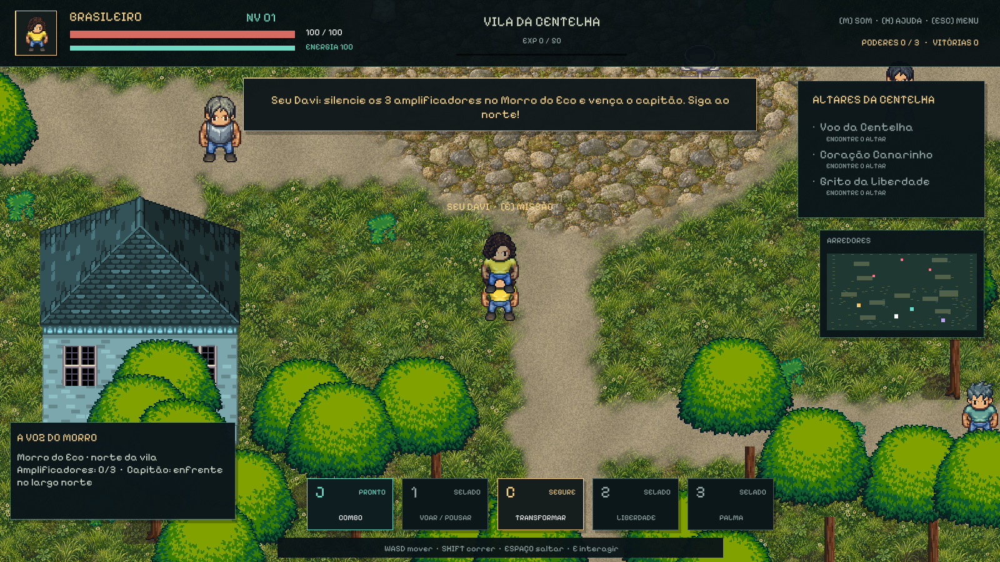
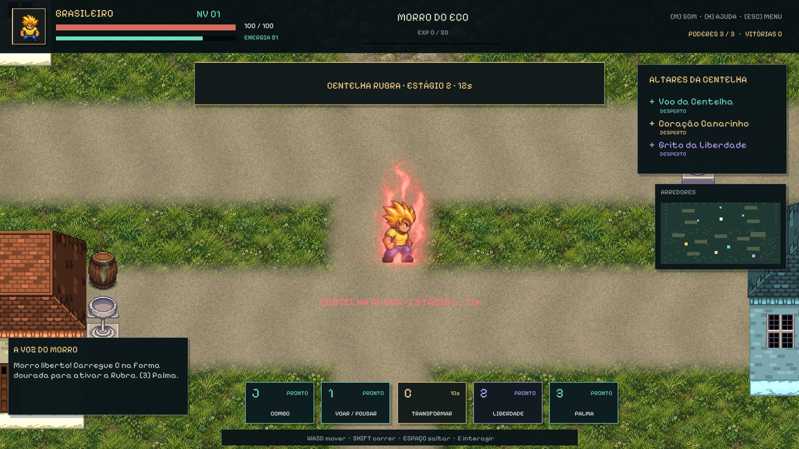
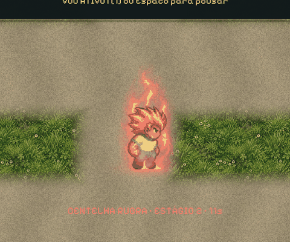

# Cibio — Vila da Centelha

**O Brasil virou uma Vuvuzela. Sua voz pode despertar a vila.**

RPG de ação em pixel art, com câmera de cima em perspectiva, exploração de um bairro brasileiro, combate corpo a corpo e poderes aprendidos em altares. Um brasileiro de camiseta amarela e verde enfrenta os cobradores, fiscais blindados e arautos que tomaram a vila.

Este repositório contém o **projeto Unity editável**, incluindo código, cenas, sprites, efeitos, sons, fontes de arte e créditos. O jogo está na fase de protótipo jogável para Windows, com teclado e mouse.



## Expansão 08 — Morro do Eco



A vila cresceu de **48×36 para 48×60 unidades**, com um bairro ao norte, novas casas, caminhos orgânicos e um largo. A composição anterior foi preservada; duas árvores foram desativadas para abrir a passagem norte. A cena continua editável.

### Missão: A voz do Morro

1. Converse com **Seu Davi**, ao sul da praça inicial, usando **E**.
2. Siga a estrada ao norte para o Morro do Eco. Derrote ou afaste os guardas e desligue os **três amplificadores** com E, depois de pousar.
3. Derrote o **Capitão do Eco**, no largo mais ao norte.
4. Volte a Seu Davi para receber **100 XP**, recuperar vida/energia e liberar **Centelha Rubra** e **Palma da Centelha**. Voo e melhoria Coração Canarinho também são concedidos caso ainda não tenham sido aprendidos.

Objetivos, amplificadores desligados, capitão e recompensa ficam no save. Uma partida antiga mantém seus níveis e altares e passa a oferecer a nova missão.

### Estágio 2: Centelha Rubra

Após a missão, transforme-se normalmente: segure C até 100% e solte. **Enquanto estiver na forma dourada**, complete uma segunda carga e solte C para ativar a Rubra. Carga incompleta preserva o estágio atual. O estágio 2 custa **25 de energia**, dura **12 segundos**, tem aura vermelha/rosada, porte adicional e dano de **3,15×**. A mudança usa os atlas completos existentes, partículas e transições de shader; o cabelo não volta ao estado normal durante a segunda transformação.

| Voo | Normal | Dourado | Rubro |
| --- | --- | --- | --- |
| Cruzeiro | 6 unidades/s | 8 unidades/s | 12 unidades/s |
| Com Shift | 7,5 unidades/s | 10 unidades/s | 15 unidades/s |
| Consumo por segundo | 10 | 7 | 9 |
| Consumo adicional com impulso | +6/s | +6/s | +6/s |

Todas as formas gastam 12 de energia para decolar. WASD controla a direção com aceleração suave; Ctrl tem prioridade sobre Shift e freia até parar no ar. Espaço ou 1 inicia pouso. Sem energia, o pouso é automático. A câmera adianta a visão durante o voo. Obstáculos continuam sólidos.

**Palma da Centelha [3]** lança um projétil na direção em que o personagem está voltado, custa 22 de energia e tem recarga de 1,8s; na Rubra, o projétil é mais rápido e a recarga cai para 1,1s. A onda [2] alcança 6,2 unidades na Rubra.

Os novos **Batedores do Morro** anunciam o bote durante 0,6s e avançam continuamente por 0,24s; o **Capitão** anuncia rajadas de três projéteis. São novos comportamentos e combinações das famílias de sprites existentes, com porte e paletas diferentes. Os golpes anunciados permitem esquiva e reposicionamento.

## O que já dá para jogar

- Explorar a vila, correr, saltar, enfrentar cinco tipos de inimigos e subir de nível.
- Encadear três golpes com poses diferentes, impacto no quadro de contato e direção travada durante cada soco.
- Despertar três altares: **Voo da Centelha**, **Coração Canarinho** e **Grito da Liberdade**.
- Segurar **C** até completar a carga e soltar para se transformar. O cabelo muda de silhueta, o corpo ganha porte e a aura envolve o personagem.
- Voar com decolagem, hover, avanço e pouso; há poses próprias para as formas normal e desperta, vento e consumo de energia.
- Usar uma onda com antecipação de animação, explosão orgânica e empurrão. Na forma desperta, ela alcança mais longe e produz uma erupção maior.
- Ouvir ambiente, passos, movimentos dos golpes, impactos, carga de energia, transformação e voo. O jogo inclui controle de picos na mixagem.
- Continuar o progresso salvo, consultar o minimapa, pausar e acessar créditos pelo menu animado.



## Controles

| Entrada | Ação |
| --- | --- |
| WASD / setas | Mover |
| Shift | Correr no chão / impulso no voo |
| Ctrl | Frear o voo e manter hover |
| J / clique esquerdo fora da interface | Socar; pressionar novamente no fim do golpe encadeia o combo |
| Espaço | Saltar no chão; iniciar pouso durante o voo |
| E | Aprender o poder do altar próximo |
| 1 | Decolar ou pousar, após aprender Voo da Centelha |
| 2 | Grito da Liberdade, após aprender no altar |
| 3 | Palma da Centelha, após concluir a missão de Seu Davi |
| C, segurar e soltar | Carregar energia; soltar com 100% ativa a transformação |
| H | Ajuda de controles |
| M | Silenciar / reativar áudio |
| Esc | Pausar / continuar |
| R | Renascer depois de cair |

### Poderes e transformação

| Sistema | Forma normal | Forma desperta |
| --- | --- | --- |
| Movimento no chão | Caminhada 2,8; corrida 4,5 unidades/s | Velocidade 1,3× |
| Voo | 6 unidades/s; 12 de energia na decolagem + 10/s | 8 unidades/s; 12 na decolagem + 7/s |
| Grito da Liberdade | 40 de energia; alcance 3,8; recarga 5s | 40 de energia; alcance 5,4; recarga 4s; explosão e empurrão maiores |
| Dano dos golpes | Cresce com o nível | Multiplicador 2,3×, com efeitos e sons reforçados |

A transformação está disponível **desde o início**, dura 16 segundos e aumenta para 24 após aprender Coração Canarinho. Soltar uma carga incompleta apenas encerra a canalização. Para carregar, o personagem precisa pousar. Energia esgotada inicia pouso automático.

O voo é baixo, acompanha a posição no mapa e respeita obstáculos e limites da vila. Inimigos corpo a corpo não alcançam o personagem na altura de cruzeiro; conjuradores continuam sendo uma ameaça. O salto também usa deslocamento visual sobre as colisões do chão.

## Abrir na Unity

1. Instale **Unity 6000.6.7f1** pelo Unity Hub, com **Windows Build Support (Mono)** para gerar o player Windows.
2. Clone o projeto:

   ```bash
   git clone https://github.com/juniorrondini/Cibio.git
   ```

3. No Hub, escolha **Add project from disk** e selecione a pasta clonada, que contém `Assets`, `Packages` e `ProjectSettings`.
4. Aguarde a importação dos assets. `Library` e outros caches são gerados localmente.
5. Abra `Assets/Cibio/RPG/Scenes/03_VilaDaCentelha.unity`, ou use **Cibio > RPG > Abrir Vila da Centelha**.
6. Pressione Play e escolha **Iniciar jornada** ou **Continuar**, conforme as opções do menu.

O projeto usa o **Built-in Render Pipeline**, renderização ortográfica e ordenação de sprites pela posição dos pés. Os módulos usados são integrados à Unity; não há dependência de pacote pago ou de chave de API para jogar ou compilar. A geração de novas ilustrações não ocorre durante a execução do jogo.

## Gerar o executável

Pelo editor, use o perfil Windows com a cena principal acima. Para uma compilação automatizada que valida a cena e prepara os materiais, execute no PowerShell, a partir da raiz do projeto:

```powershell
$unity = 'C:\Program Files\Unity\Hub\Editor\6000.6.7f1\Editor\Unity.exe'
$project = (Get-Location).Path
& $unity -batchmode -quit -projectPath $project `
  -executeMethod Cibio.RPG.Editor.RpgExpansion08.BuildPlayer `
  -cibio-build "$project\Builds\Windows\Cibio.exe" `
  -logFile "$project\build.log"
```

Feche o editor desse mesmo projeto antes de executar o modo batch. A cena contém a vila composta e editável. Os métodos antigos `Build` e `BuildPlayer` recriam o mapa; use **BuildUpdatedPlayer** nas atualizações para preservar essa composição.

## Verificação

**Última revisão Windows (08): 425 verificações passaram** — 382 da base e 43 da expansão, incluindo missão completa, save antigo, reset visual de nova partida, dano, esquiva dos novos inimigos e projéteis contra paredes. Foram percorridos 564 quadros de animação nas quatro direções e nas três formas; 384 células dos dois atlas de personagem foram auditadas quanto à presença de conteúdo e aos limites ocupados. Relatórios em [docs/verification](docs/verification).

O player inclui revisão automatizada com verificações de movimentação, colisão, altares, transformação ao soltar C, direções e dimensões dos atlas, combate, voo, áudio e recuperação de progresso. A revisão 07 também executa uma cena controlada para conferir a onda desperta a 4,6 unidades, grava o áudio nativo e mede 120 quadros sem capturas.

```powershell
.\Builds\Windows\Cibio.exe -cibio-review08 "$PWD\Review08" -logFile "$PWD\review08.log"
```

O processo fecha ao concluir. Consulte `Verificacao-RPG.txt`, `Expansao-08.txt`, `Balanceamento-08.txt`, `Quadros-08.txt` e `Desempenho-08.txt`. A sequência visual usa passo fixo de 24fps; as revisões preservam o save do jogador. `Quadros-08.txt` registra os ciclos completos de caminhada, corrida, voo e três golpes nas quatro direções e nas três formas.

Na amostra final de 120 quadros, parado com a Rubra ativa e sem gravar imagens, foram observados **56,5 FPS** nesta máquina com Intel UHD Graphics 630. O resultado é uma amostra breve, sem representar combate completo ou outras máquinas. A prévia em vídeo não tem áudio; a gravação sonora independente `Som-07.wav` continua disponível no modo anterior `-cibio-review07`.


O progresso normal usa a chave `Cibio.RPG.v3.Progress` do PlayerPrefs e não fica no repositório.

Os modos anteriores `-cibio-review` e `-cibio-vfx-review` continuam disponíveis. Esta é uma verificação de protótipo em uma máquina Windows; desempenho e aparência precisam ser conferidos também nos dispositivos de destino.

### Resultados e revisão visual da versão 08

O combo de três contatos no nível 1 causou **73,4 / 168,8 / 231,2** de dano nas formas normal/dourada/rubra. São simulações controladas; o ajuste final de dificuldade ainda precisa de sessões com jogadores. Os avisos do batedor e do capitão, contato único, ameaça dos projéteis durante o voo e recuperação do save também foram exercitados no player.

O [mapa ampliado](docs/images/mapa08.png), a [caminhada quadro a quadro](docs/images/quadros08-walk.png) e os [socos em sequência](docs/images/quadros08-thrust.png) permitem conferir o resultado. Alguns frames LPC originais têm a sola no limite da célula; esse contato foi registrado no relatório, mantendo as células nativas.

## Organização

```text
Assets/
  Cibio/RPG/
    Scenes/          Vila da Centelha editável
    Scripts/         Personagem, mundo, câmera, interface, poderes e verificações
    Editor/          Importadores, abertura da cena e compilação
    Resources/       Sprites, shaders, materiais, áudio e fonte
    ThirdParty/      Originais, atribuições, licenças, prompts e receitas
  StreamingAssets/
    Cibio-Licenses/   Créditos e fontes que acompanham a distribuição
Packages/            Manifesto e dependências da Unity
ProjectSettings/     Configuração do projeto
docs/                Imagens e resultados da revisão
```

As pastas de protótipos anteriores em `Assets/Cibio` estão preservadas. O desenvolvimento atual concentra-se em `Assets/Cibio/RPG`.

| Código | Responsabilidade |
| --- | --- |
| `RpgActor` | Movimento, fase dos passos, combo, carga, salto e altura de voo |
| `RpgGame` | Entrada, câmera, sessão, progressão e liberação dos poderes |
| `RpgWorld` / `RpgSolid` | Composição e colisões do mapa |
| `RpgPowerForm` | Transição e composição da forma desperta |
| `RpgAura` / `RpgEnergyParticles` / `RpgEffects` | Aura em camadas, partículas texturizadas e impactos |
| `RpgEnergyBloom` | Brilho seletivo dos efeitos na camada 29 |
| `RpgAudio` / `RpgAudioLimiter` | Camadas sonoras, loops e controle de picos |
| `RpgVerification` / `RpgReview07` | Verificações e capturas no player nativo |

Preserve os arquivos `.meta` e GUIDs. Personagens LPC usam células de 64px e PPU32; a forma desperta usa 128px e PPU64. O código consulta `RpgArt.CellSize` e `FrameCount` para manter as duas famílias compatíveis.

## Arte, áudio e licenças

O repositório contém materiais com **licenças diferentes**. Consulte as atribuições por arquivo antes de reutilizar ou redistribuir assets; não presuma que uma licença única cobre todo o conteúdo.

- **Personagens LPC e derivados:** autores e camadas em [CharacterCredits.csv](Assets/Cibio/RPG/ThirdParty/CharacterCredits.csv), textos CC BY-SA e fontes em `ThirdParty/LPCCharacter`. Composições LPC desta versão são distribuídas sob CC BY-SA 4.0; atribuições e opções dos originais acompanham os arquivos.
- **Cenário LPC, telhados e construções coloniais:** originais e atribuições em `ThirdParty/LPCTerrain`, `Colonial` e `Roofs`, incluindo licenças herdadas.
- **Sons CC0:** Kenney, rubberduck, TinyWorlds, qubodup/Independent.nu e faxcorp. Fontes em [Audio-CC0.txt](Assets/Cibio/RPG/ThirdParty/Audio-CC0.txt), [Audio-05.txt](Assets/Cibio/RPG/ThirdParty/Audio-05.txt) e `SoundDesign07/Audio-07.txt`. As receitas de design sonoro e gravações utilizadas acompanham o projeto.
- **Pixelify Sans:** SIL Open Font License 1.1, incluída em `ThirdParty/PixelifySans-OFL.txt`.
- **Ilustrações, transformação e efeitos gerados para Cibio:** originais, prompts e importadores em `ThirdParty/Generated05`, `GeneratedVfx06` e `Generated07`. O voo 07 foi criado com a ferramenta integrada **image_gen**, usando os personagens do projeto como referência; o importador apenas registra, recorta e dimensiona os quadros.

Não são usados sprites ou sons extraídos dos jogos e animes citados como referência. Os créditos permanecem acessíveis no menu do jogo, e as fontes acompanham `StreamingAssets/Cibio-Licenses`.

Assets novos de voo: [Hero_flight.png](Assets/Cibio/RPG/Resources/RpgArt/Hero_flight.png) e [HeroAwakened_flight.png](Assets/Cibio/RPG/Resources/RpgArt/HeroAwakened_flight.png). O [prompt completo](Assets/Cibio/RPG/ThirdParty/Generated07/Prompt-Complete-07.txt) registra a criação com `image_gen` integrado; original e importador ficam na mesma pasta.

## Próximas etapas

Ampliar a variedade de missões, criar arte exclusiva para os novos arquétipos e testar o balanceamento com jogadores em mais máquinas. A expansão 08 implementa a primeira missão completa, dois arquétipos adicionais, um poder à distância e a segunda transformação. O estado atual oferece uma área de combate e progressão para iterar nesses sistemas.
