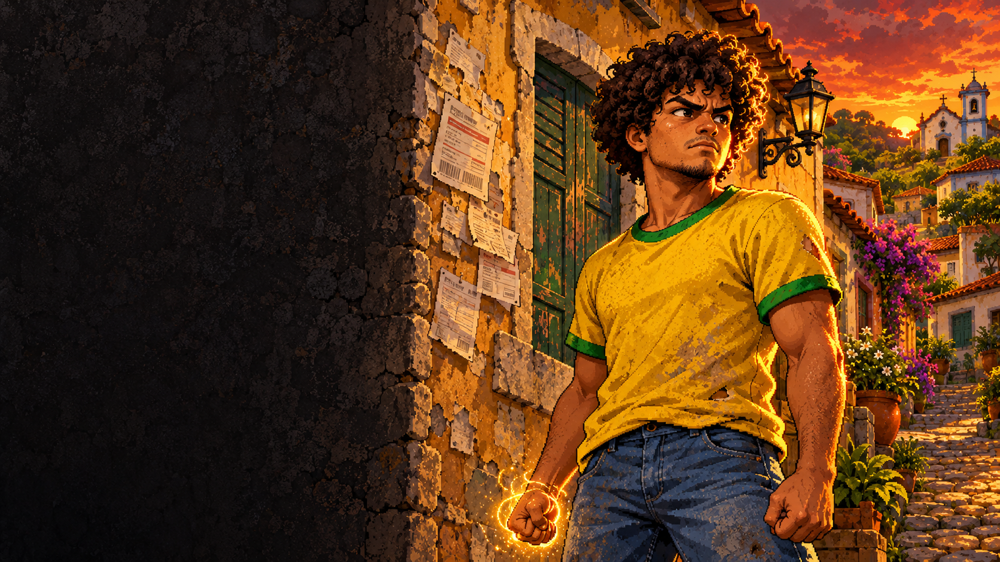
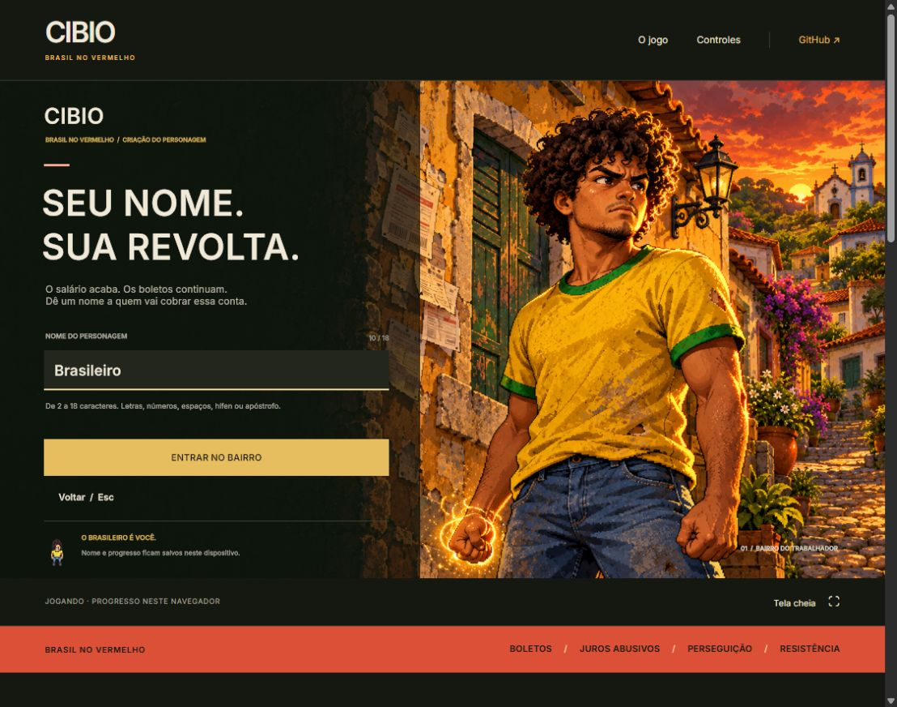

<div align="center">

# CIBIO

**BRASIL NO VERMELHO**

Um trabalhador. Muita conta a acertar.

**[JOGAR NO NAVEGADOR ↗](https://cibio-brasil-no-vermelho.viniandfriends.chatgpt.site)**

[O jogo](#o-jogo) · [Como jogar](#como-jogar) · [Controles](#controles) · [Desenvolvimento](#desenvolvimento) · [Créditos](#créditos-e-licenças)

</div>



> **Chega de pagar calado.** No Brasil da Vuvuzela, sua revolta vira poder.

RPG de ação **single player**, em pixel art com perspectiva superior, ambientado numa sátira política ficcional brasileira. Explore a ilha, encadeie golpes, desperte poderes e enfrente o sistema de **Companheiro**.

| Versão atual | Engine | Plataformas | Idioma |
|:---:|:---:|:---:|:---:|
| **20 · Revolta** | Unity **6000.6.7f1** | WebGL 2 e Windows | Português brasileiro |

## O jogo

O salário acaba antes dos boletos. As dívidas crescem, os juros sufocam e os agentes mantêm o bairro com medo. **Seu Bonero** tem uma pista: no **Distrito do Poder**, três registros podem expor o esquema de Companheiro.

### Brasil no Vermelho

| Investigue | Encontre |
|---|---|
| **Central de Cobrança** | Boletos duplicados e juros sobre juros |
| **Arquivo da Perseguição** | Registros de multas e intimidações contra críticos |
| **Central de Apuração** | O log adulterado da apuração do distrito ficcional |

Afaste os agentes, recolha as provas, derrote Companheiro e entregue o dossiê a Seu Bonero. **N** reúne seus achados e mostra o próximo objetivo. [Leia a direção narrativa](docs/NARRATIVA.md).

### Sua revolta tem movimento

- **Combate:** combo com três golpes, comando antecipado, finalizador, esquiva e contra-ataque por talento.
- **Poderes:** aura orgânica, transformação dourada, Forma Ascendente, Onda e Palma. As formas mudam cabelo, silhueta, animações e impacto.
- **Evolução:** um ponto de talento por nível; nove talentos em três linhas, com dependências e reorganização em segurança.
- **Exploração:** ilha de 96 × 112 unidades, bairro, distrito, praia, mata, trapiche, farol e reservas de emergência.
- **Voo:** decolagem, impulso, freio, sonic boom e aceleração orbital na Forma Ascendente.
- **Inimigos:** cobradores, fiscais, conjuradores, agentes e chefes com antecipação de ataques e fases próprias.

<details>
<summary><strong>Há algo além da ilha… (spoiler do easter egg)</strong></summary>

Na Forma Ascendente, decole com **1** e mantenha **Shift**. O voo orbital atravessa obstáculos e conta o deslocamento real pelo mapa. A velocidade cresce **20% por volta**; a quinta abre uma ruptura temporal audiovisual.

Complete dez voltas para revelar o mundo-vuvuzela e enfrentar **Bonero Companheiro**, literalmente dividido entre os dois personagens. A vitória única concede **350 XP e um ponto extra de talento**. Soltar Shift, frear com Ctrl ou pousar cancela a tentativa e devolve o personagem a chão seguro.


[Chefe animado](docs/images/bonero-companheiro16.gif) · [Arena](docs/images/arena16.png)

</details>

## Como jogar

1. Abra **[Cibio online](https://cibio-brasil-no-vermelho.viniandfriends.chatgpt.site)** em um computador com teclado, mouse e WebGL 2. O primeiro carregamento baixa os arquivos do Unity.
2. Clique em **Jogar agora** na página e depois em **Jogar** no menu do game.
3. Dê um nome ao Brasileiro: **2 a 18 caracteres**, com acentos, números, espaços, hífen ou apóstrofo. **Enter** confirma; **Voltar/Esc** cancela.
4. Converse com **Seu Bonero**, ao sul da praça, usando **E**. Siga para o Distrito do Poder ao norte.

O nome aparece no HUD e fica salvo com o progresso. Ao continuar, ele já vem preenchido. A versão 20 refina a tela de nome e a página com arte original, tipografia mais marcante e uma identidade de carvão, papel, amarelo gasto e vermelho.



### Progresso

No Web, nome e progresso ficam **neste navegador**. Na versão Windows, usam o PlayerPrefs local; os dois saves são separados. Pause com **Esc** para salvar antes de fechar a aba.

A chave `Cibio.RPG.v3.Progress` e os estados anteriores foram preservados. Níveis, talentos, poderes, missões e recompensas já obtidos continuam válidos. Os temas econômicos fazem parte da narrativa e dos objetivos de investigação.

## Controles

| Ação | Comando |
|---|---|
| Mover | **WASD** ou setas |
| Correr / impulsionar o voo | **Shift** |
| Combo de socos | **J** ou clique esquerdo |
| Esquivar no chão | **Alt** ou botão direito |
| Conversar / investigar / interagir | **E** |
| Carregar e transformar | Segure **C** até 100% e solte |
| Evoluir à Forma Ascendente | Pressione **C** novamente enquanto dourado |
| Decolar / pousar | **1**, após obter voo |
| Frear o voo | **Ctrl** |
| Saltar / pousar | **Espaço** |
| Onda / Palma | **2 / 3**, após desbloquear |
| Talentos / dossiê | **T / N** |
| Pausa / ajuda / áudio | **Esc / H / M** |
| Retomar após cair | **R** |

## Desenvolvimento

### Abrir no Unity

```powershell
git clone https://github.com/juniorrondini/Cibio.git D:\Cibio
```

Adicione `D:\Cibio` no Unity Hub e abra com **6000.6.7f1**. Para compilar Web, instale também **WebGL Build Support**. A cena editável está em:

```text
Assets/Cibio/RPG/Scenes/03_VilaDaCentelha.unity
```

O menu **Cibio → RPG → Abrir Vila da Centelha** abre essa cena. O nome interno permanece por compatibilidade; a campanha se apresenta como **Bairro do Trabalhador / Distrito do Poder**.

### Compilar Windows

```powershell
$project = 'D:\Cibio'
& 'C:\Program Files\Unity\Hub\Editor\6000.6.7f1\Editor\Unity.exe' `
  -batchmode -quit -projectPath $project `
  -executeMethod Cibio.RPG.Editor.RpgBuilder.BuildUpdatedPlayer `
  -cibio-build "$project\Builds\Windows\Cibio.exe" `
  -logFile "$project\build-windows.log"
```

`BuildUpdatedPlayer` preserva a cena salva. Os geradores antigos `Build/BuildPlayer` recriam o mapa. Mantenha `.meta`, GUIDs e as configurações internas de company/product que determinam o local do save.

### Compilar e publicar Web

O mesmo jogo roda em WebGL. O builder aplica compressão de textura apenas durante o build e restaura as configurações de origem. O site recebe data/wasm em partes gzip com verificação SHA-256.

**[Instruções Web, fontes da página e publicação →](Web/README.md)**

| Diretório | Conteúdo |
|---|---|
| `Assets/Cibio/RPG/Scripts` | Movimento, combate, poderes, missão, talentos, save e interface |
| `Assets/Cibio/RPG/Resources` | Sprites, áudio, materiais, shaders e fontes |
| `Assets/Cibio/RPG/ThirdParty` | Originais, prompts, importadores, receitas e atribuições |
| `Assets/StreamingAssets/Cibio-Licenses` | Fontes e licenças distribuídas com o player |
| `Web` | Frontend, preparo do build e referência da publicação Sites |
| `docs` | Narrativa, capturas e relatórios de verificação |

## Verificação

**1.167 verificações automatizadas aprovadas**, incluindo 31 de nomes, Unicode, criação/cancelamento, continuação, serialização e proteção do save real. A revisão também exercita combate, transformações, missão, talentos, voo, arena e ruptura temporal.

```powershell
.\Builds\Windows\Cibio.exe -cibio-identity-review19 ".\Review" -logFile ".\review.log"
```

O modo de revisão preserva o save e encerra ao terminar. Os relatórios identificam a execução e as limitações de cada captura. Revisão visual e testes controlados acompanham o desenvolvimento; o projeto continua em fase de **protótipo jogável**.

[Identidade e save](docs/verification/Identidade20.txt) · [Auditoria da versão 20](docs/verification/Direcao-Audit20.json) · [Relatórios anteriores](docs/verification)

## Créditos e licenças

As licenças variam por arquivo. O menu **Créditos**, a página pública e o player mantêm as atribuições acessíveis.

| Material | Origem e documentação |
|---|---|
| Personagens e animações LPC | [Autores e camadas](Assets/Cibio/RPG/ThirdParty/CharacterCredits.csv); composições e derivados sob CC BY-SA 4.0, com atribuições herdadas |
| Cenário LPC e construções | `ThirdParty/LPCTerrain`, `Colonial` e `Roofs`; licenças por conjunto |
| Arte original da direção visual 20 | [Fontes e prompt completo](Assets/Cibio/RPG/ThirdParty/Generated20/README.md), criada com **ImageGen integrado**; Cibio CC BY-SA 4.0 |
| Transformações, chefes e efeitos | Originais, prompts e importadores nos diretórios `Generated*` |
| Sons | Samples CC0 e design próprio; fontes/receitas em `SoundDesign*` e `Audio-CC0.txt` |
| Tipografia | Cibio UI derivada de Inter; Pixelify Sans. Licenças OFL preservadas |

[Créditos completos](Assets/Cibio/RPG/Resources/RpgCredits.txt) · [Fontes e licenças distribuídas](Assets/StreamingAssets/Cibio-Licenses/FONTES-E-LICENCAS.txt)

---

**[Jogar Cibio ↗](https://cibio-brasil-no-vermelho.viniandfriends.chatgpt.site)** · [Histórico das versões anteriores](docs/HISTORICO.md)
