# Cibio — Vila da Centelha

**O Brasil virou uma Vuvuzela. Sua voz pode despertar a vila.**

RPG de ação em pixel art com câmera em perspectiva, exploração de um bairro brasileiro, combos, poderes e progressão. Projeto Unity editável, em fase de protótipo jogável para Windows.

## Versão 15 — Talentos e A décima volta

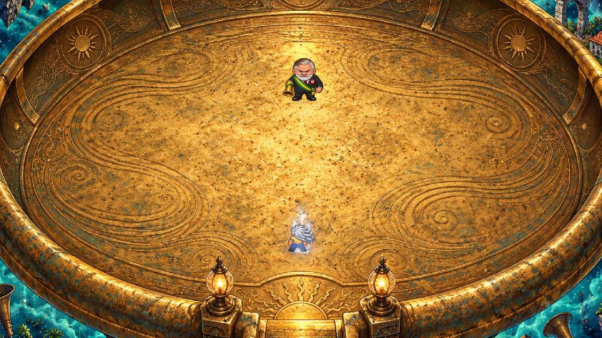


**T** abre os talentos e pausa o mundo. Cada nível concede um ponto, inclusive nos saves antigos. São três linhas, com dois talentos de três graus e um talento final em cada uma; 21 pontos completam tudo. Investir exige os graus anteriores. Reorganizar é gratuito quando está longe dos inimigos e fora da arena secreta.

| Linha | Talentos |
|---|---|
| Impacto | Punhos de Aço: mais dano de soco; Ritmo Perfeito: finalizador forte; Último Acorde: eco atrasado de dano |
| Centelha | Fôlego: regeneração de energia; Reserva Viva: custo menor e formas mais longas; Pulso em Cadeia: Palma atinge mais dois inimigos |
| Vanguarda | Passo Leve: esquiva mais barata e rápida; Caçador da Brisa: corrida/voo mais velozes; Contratempo: esquiva precisa prepara um soco com +75% de dano |

O **easter egg** começa na Forma Ascendente: decole com **1** e mantenha **Shift**. O voo orbital atravessa construções e água, acelera de 60 até 104 u/s e atravessa as bordas do mapa, reaparecendo no lado oposto. A direção inicial define o eixo da volta. Recuar na borda não fabrica voltas. O impulso sustenta a energia e a forma durante a órbita; soltar Shift, frear com Ctrl ou pousar cancela a tentativa e recupera uma posição segura.

Na **décima volta**, uma sequência própria revela o mundo se tornando uma vuvuzela e leva à arena na boca do instrumento. **Bonero Companheiro** mistura os dois personagens, com 128 quadros próprios e manopla de sopro. A luta tem combo de três contatos, leques de voz, investida e uma segunda fase com dois leques em eixos diferentes. Golpes têm antecipação, contato e recuperação. Ondas de voz também alcançam quem estiver voando; a esquiva serve como resposta.

A primeira vitória dá **350 XP e um ponto extra de talento**. R reinicia uma tentativa na arena; após vencer, E retorna à vila. O farol guarda a passagem para revisitar a convergência. Descoberta, vitória e recompensa ficam no save v3. Sair durante uma descoberta pendente permite retomar o chefe ao continuar; coordenadas da arena nunca substituem o ponto de retorno na vila. A missão original permanece independente.

[Arte, originais, prompts e importador](Assets/Cibio/RPG/ThirdParty/Generated15/README.md) · [Receita dos sons](Assets/Cibio/RPG/ThirdParty/SoundDesign15/README.md)

**Verificação:** 1.011 verificações passaram: 870 regressões e 141 ensaios da atualização. Foram renderizados 128 quadros do chefe, 144 quadros de trechos dos ataques e 16 do voo orbital pelo próprio Unity. Onze assets e dez sons foram reproduzidos byte a byte. A cena permaneceu byte a byte idêntica e os GUIDs anteriores foram preservados.

[Relatório](docs/verification/Convergencia15.txt) · [Auditoria](docs/verification/Convergencia-Audit15.json) · [Animações do chefe](docs/images/bonero-companheiro15.gif) · [Trechos dos ataques](docs/images/ataques-fusao15.gif) · [Órbita](docs/images/orbita15.gif) · [Quadros completos](docs/images/quadros-fusao15.jpg)

[Mundo-vuvuzela — arte](docs/images/mundo-vuvuzela15.jpg) · [Oito painéis da metamorfose — arte](docs/images/metamorfose-paineis15.jpg) · [Ícones dos talentos — arte](docs/images/talentos-icones15.png)

Limite da revisão: o Windows negou a captura da janela (`GetCursorPos`, acesso negado). O painel de talentos e os overlays da sequência não tiveram inspeção visual da janela nesta execução. Capturas vazias foram excluídas; as imagens publicadas da arena e dos personagens são renders diretos de câmera Unity. Não foi medido desempenho por essas capturas.

Revisão: `Cibio.exe -cibio-chronicle-review15 "Review15" -logFile "review15.log"`. Ensaios de talentos, voo, bordas, pausa, save, arena, ataques, fase e recompensa. As regressões anteriores isolam o novo controlador orbital; o voo intangível é verificado separadamente. O modo preserva o save real.

## Versão 14 — Costa da Brisa e combate

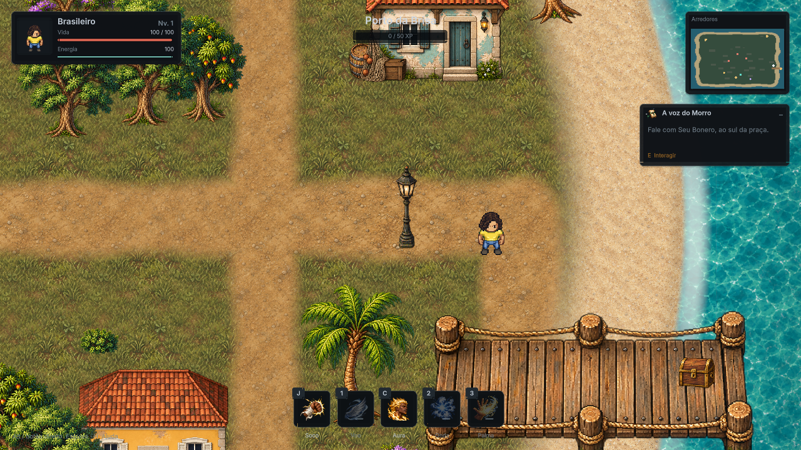

O mapa passou de 64×72 para **96×112 unidades**, mantendo a vila e acrescentando costa orgânica, mar animado, praia, trapiche, barcos, casa de pescador, mata e farol. Rotas pelos dois lados da capela conectam o Largo à região norte; caminhos laterais chegam ao porto e às praias. O minimapa mostra água, areia, terra e esconderijos. O mar limita a exploração; o trapiche é uma superfície acessível sobre a água.

Oito novos inimigos ocupam os caminhos. Três **esconderijos** recompensam exploração com 45 XP e recuperação de 20 de vida/energia. Abra com **E**, no chão, depois de afastar inimigos próximos. A recompensa é única e fica no mesmo save v3. Seu Bonero, Companheiro e a missão anterior foram mantidos.

### Combate

- **Alt ou botão direito** executa uma esquiva curta no chão: 10 de energia, 0,85 s de recarga, 0,20 s de movimento e 0,13 s de proteção inicial. A direção acompanha o movimento; sem direção, usa a orientação atual. A esquiva respeita paredes e costa.
- **J ou clique** aceita o comando antecipado para o próximo golpe. Um comando enfileira um golpe; a sequência usa três animações e contatos distintos. O movimento volta durante a recuperação final, e a esquiva pode cancelar essa recuperação.
- Socos respeitam frente, alcance e paredes. Acertos geram reação curta; o finalizador interrompe inimigos comuns. Blindados e chefe resistem mais, evitando interrupção permanente do chefe.
- Formas dourada/Ascendente mantêm seus poderes e aumentam o deslocamento visual/real da esquiva. Dano dos golpes, custos e recargas dos poderes e supersônico de 60 u/s permanecem.

[Combate em movimento](docs/images/combate14.gif) · [Revisão dos quadros](docs/images/quadros-combate14.jpg) · [Mapa](docs/images/ilha14.png) · [Farol](docs/images/farol14.png) · [Trapiche](docs/images/trapiche14.png) · [Praia](docs/images/praia14.png) · [Originais, sprites, prompts e importador](Assets/Cibio/RPG/ThirdParty/Generated14/README.md)

**Verificação da versão 14:** 872 verificações passaram: 382 da base, 75 da evolução, 75 da vila, 157 do chefe, 64 da Palma e 119 da ilha/combate. A revisão gerou 54 quadros dos combos e 28 da esquiva, além das novas regiões. Todos os 8.040 blocos originais da cena e os GUIDs existentes foram preservados. Os 12 assets novos foram reproduzidos byte a byte com o importador incluído.

[Relatórios](docs/verification/Ilha-Combate14.txt) · [Balanceamento controlado](docs/verification/Balance14.csv) · [Integridade da cena](docs/verification/Scene-Audit14.json) · [Baú aberto](docs/images/bauaberto14.png) · [Quadros da esquiva](docs/images/quadros-esquiva14.jpg)

No ensaio de golpes contra alvos estacionários no nível 1, o chefe levou 6,525 s na forma base, 3,042 s na dourada e 1,842 s na Ascendente. O ensaio não inclui aproximação, esquivas ou decisões da IA; orienta a comparação entre formas e não substitui sessões de jogo. Dano e vida anteriores foram mantidos.

A amostra local de desempenho está em [Desempenho14.txt](docs/verification/Desempenho14.txt): 120 quadros a 1280×720, sem gravar imagens nesse trecho, em Intel UHD 630. É uma amostra curta desta máquina; o jogo ainda é um protótipo e precisa de otimização e testes em outras configurações.

Revisão: `Cibio.exe -cibio-island-review14 "Review14" -logFile "review14.log"`. Inclui regressões, rotas, costas, recompensas, combos, esquiva, dano e um ensaio de tempo para derrotar alvos estacionários. As capturas e os ensaios preservam o save real.

## Versão 13 — a vila na tela inicial e nova Palma

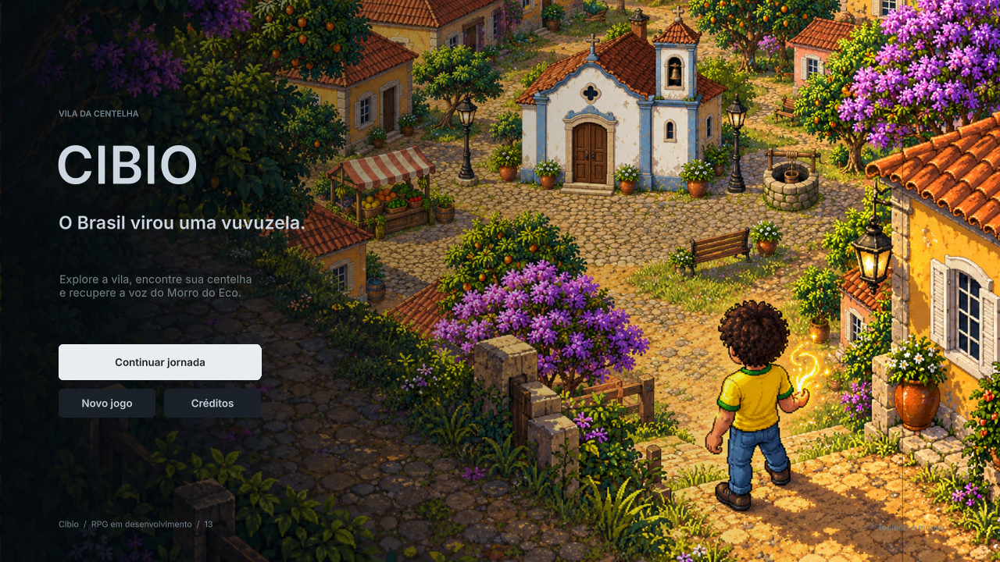

A abertura agora mostra o brasileiro de camiseta amarela e cabelo castanho encaracolado diante da própria vila: casas coloniais, capela, feira, poço, ipês e caminhos de pedra. A perspectiva e a paleta acompanham o jogo. O fundo conserva a animação suave e uma área livre para a leitura do menu.

A **Palma da Centelha (tecla 3)** ganhou um ícone exclusivo com mão aberta e energia legível na barra. O projétil tem **16 quadros próprios**, com núcleo luminoso e cauda fluida; o impacto tem outros **16 quadros** de expansão e dissipação. O efeito cresce visualmente nas formas dourada e Ascendente, conservando o custo de 22, dano, velocidades 8/11 e recargas 1,8/1,1 s. A colisão continua no chão, com um único impacto; paredes também recebem o efeito. Os projéteis dos inimigos permanecem com sua própria arte.

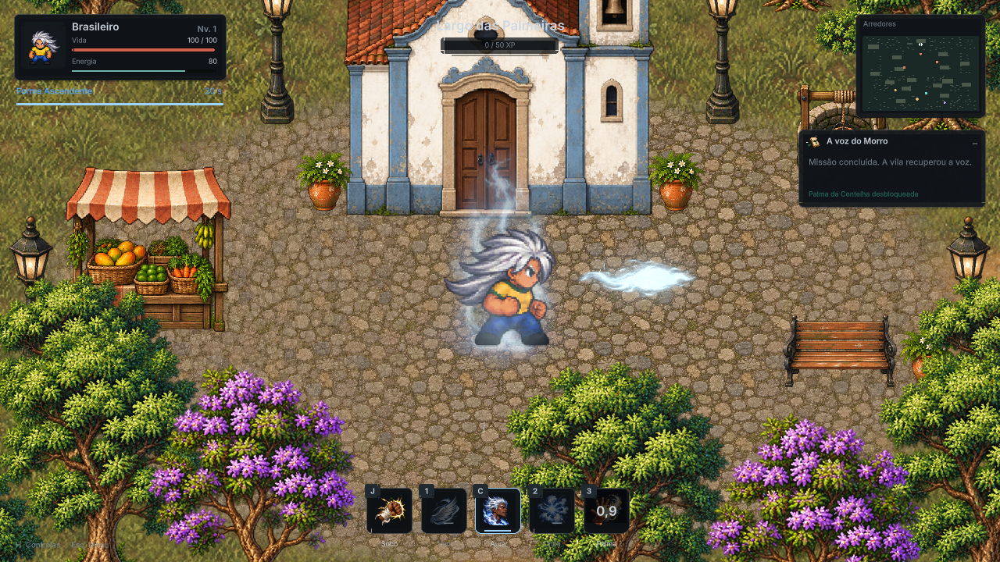

[Animação](docs/images/palma13.gif) · [Ícone e descrição](docs/images/skill3-13.png) · [Impacto](docs/images/impacto13.png) · [Originais, sprites finais, prompts e importador](Assets/Cibio/RPG/ThirdParty/Generated13/README.md)

Revisão: `Cibio.exe -cibio-art-review13 "Review13" -logFile "review13.log"`. Captura menu, 32 quadros e as quatro direções em três formas, preservando o save real.

## Versão 12 — Companheiro e Seu Bonero

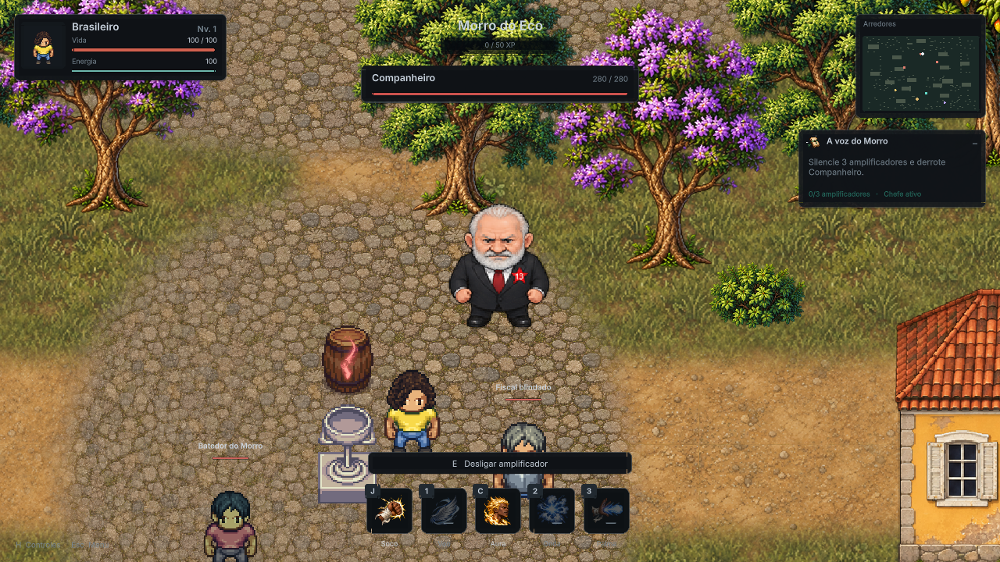

O chefe da missão **A voz do Morro** agora é **Companheiro**, com arte própria inspirada na referência enviada: barba e cabelo brancos, terno escuro, gravata vinho e **estrela vermelha com o número 13 no peito**. São **128 quadros** exclusivos em quatro direções, cobrindo respiração, caminhada, soco, poder e derrota. A barra do chefe mostra nome e vida durante a aproximação. A ficha preserva 280 PV, soco 26 e leque de três projéteis de 16 cada.

O soco funciona de perto e aplica dano no quadro de contato; à distância, o poder antecipa por 850 ms antes de disparar. Os quadros de liberação e recuperação acompanham o disparo. O antigo Seu Davi passa a se chamar **Seu Bonero** nas falas, objetivos, identificação e interface, mantendo seus sprites e gestos próprios.

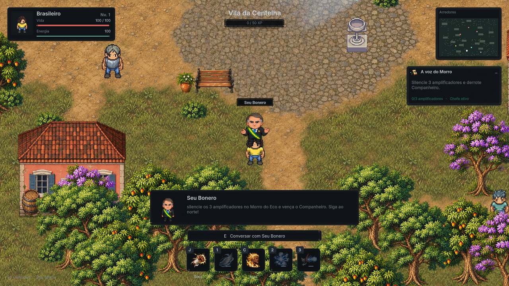

O save v3 conserva o progresso e a recompensa única. Quem já derrotou o chefe continua com o objetivo concluído. A vila 64×72, seus objetos, GUIDs e missões anteriores permanecem preservados.

[Animações](docs/images/companheiro12.gif) · [Soco](docs/images/soco12.png) · [Poder](docs/images/poder12.png) · [Quadros](docs/images/companheiro-quadros12.jpg) · [Originais, prompts e importador](Assets/Cibio/RPG/ThirdParty/Generated12/README.md)

Para revisar: `Cibio.exe -cibio-boss-review12 "Review12" -logFile "review12.log"`. O modo exercita combate, missão, save e 128 quadros nativos, preservando o save real.

## Versão 11 — Seu Davi e Largo das Palmeiras

Seu Davi ganhou **arte própria**, inspirada nos traços e no vestuário da referência enviada: cabelo grisalho, terno escuro, gravata azul e faixa verde/amarela. São **32 quadros** em quatro perspectivas, com idle e gestos de conversa. Ele olha para o personagem quando você se aproxima, tem colisão própria, identificação no cenário e um painel de diálogo com retrato. A missão A voz do Morro e suas recompensas continuam funcionando.

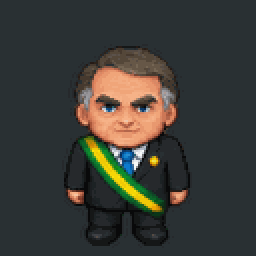

A vila passou de 48×60 para **64×72 unidades**, ampliando a área em **60%**. O Largo das Palmeiras conecta o norte às novas ruas laterais, com três casas novas, pequena capela, lago, banca de feira, bancos, lampiões, vasos e poço. O calçamento foi reduzido à escala dos personagens; terra/grama se misturam por bordas suaves. Árvores, vegetação, construções, pedras e lagos receberam novas imagens, com materiais mais detalhados e paleta consistente. Sombras suaves dão contato com o chão; os lagos têm colisão elíptica para liberar os cantos da margem.

A avenida leste/oeste comporta o voo supersônico. Uma casa que bloqueava o eixo central foi movida; obstáculos de vegetação que fechavam as novas passagens foram desativados, sem apagar os objetos. A expansão e os detalhes permanecem editáveis na cena Unity.

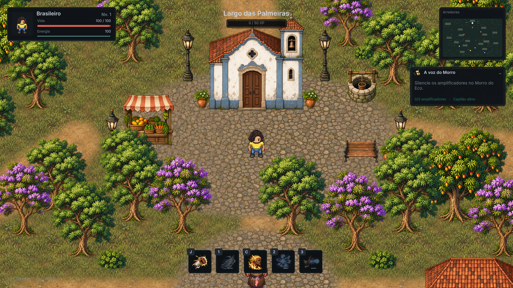

[Mapa completo](docs/images/mapa11.png) · [Largo](docs/images/largo11.png) · [Lago](docs/images/lago11.png) · [Quadros de Seu Davi](docs/images/davi-quadros11.jpg)

Fontes, prompts finais e importador: [Generated11](Assets/Cibio/RPG/ThirdParty/Generated11/README.md). Todos os novos desenhos foram criados com image_gen integrado; a referência enviada não é distribuída com o projeto.

## Versão 10 — Ruptura supersônica

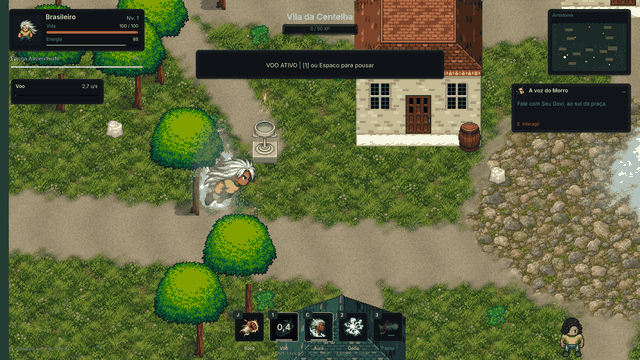

O boom ganhou **dois estalos de pressão, subgrave descendente e uma cauda mais encorpada**. A mixagem reduz brevemente ambiente/aura/vento por 320 ms para destacar a ruptura, sem alterar o volume do sistema; o limiter permanece ativo. Há um loop específico de vento supersônico.

Ao completar 18 unidades com Shift na Forma Ascendente, a velocidade salta de 15 para **42 u/s no quadro da ruptura** e acelera até **60 u/s**: quatro vezes o impulso inicial e 2,5 vezes o supersônico anterior. O rastro está mais denso, a nuvem de pressão maior e a câmera abre mais rápido, com acompanhamento mais firme para manter o personagem visível. Ctrl continua freando; colisões e consumo de 18 energia/s preservados.

**Validação da versão 10:** 469 verificações passaram (382 da base, 75 da evolução e 12 do supersônico). Velocidade real medida de **59,95 u/s**; freio testado em 333 ms; colisão com parede fina testada em um quadro de 200 ms. Mixagem nativa sem clipping, pico 0.940. O ataque inicial do novo som tem aproximadamente +12 dB de RMS na comparação dos arquivos com os ganhos usados no jogo; essa medida não representa volume acústico do dispositivo. Relatórios em [docs/verification](docs/verification).

## Versão 09 — Forma Ascendente

Segure **C** até completar a carga e solte para despertar a forma dourada. Depois que a transformação terminar, **pressione C novamente** para evoluir imediatamente ao estágio 2. Não exige outra carga nem conclusão da missão. A evolução custa **25 de energia**, dura **16 segundos** e também funciona durante o voo.

A Forma Ascendente tem sprites próprios em quatro perspectivas, cabelo prateado com uma silhueta nova, oito etapas de transformação, aura azul e branca, partículas, duas erupções, mudança de porte e novos efeitos sonoros. O cabelo muda de desenho durante a evolução. Manter C pressionado não repete a transformação. A ativação trava o movimento por 1,7s; depois, o controle volta ao jogador.

Dez ciclos exclusivos cobrem idle, caminhada, corrida, salto, três golpes, canalização, voo e dano. As fontes geradas foram registradas nos pés e normalizadas para evitar saltos de escala. Os atlas usam células transparentes de 192px, PPU64; a célula maior dá espaço ao cabelo e aos golpes. A composição aumenta o porte para a forma final.

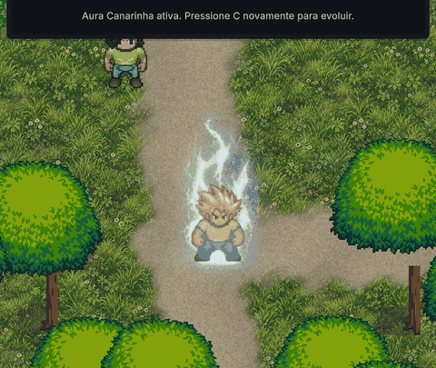

### Voo supersônico

Na Forma Ascendente, voe com **1**, mantenha **Shift** e percorra **18 unidades** para disparar o sonic boom: nuvem de vapor animada, som de ruptura, rastro de poses e aumento de velocidade para **60 unidades/s**. A câmera abre a visão conforme a velocidade aumenta.

| Voo | Normal | Dourado | Ascendente |
| --- | --- | --- | --- |
| Cruzeiro | 6 u/s | 8 u/s | 12 u/s |
| Impulso com Shift | 7,5 u/s | 10 u/s | 15 u/s |
| Após sonic boom | — | — | 60 u/s |
| Consumo em cruzeiro | 10/s | 7/s | 9/s |
| Consumo com impulso | 16/s | 13/s | 15/s |
| Consumo supersônico | — | — | 18/s |

Decolar custa 12 de energia. **Ctrl** freia até hover; **1** ou **Espaço** inicia pouso. Frear, soltar o impulso, pousar, inverter fortemente a direção ou ficar bloqueado reinicia a distância do sonic boom. A contagem usa deslocamento real: empurrar uma parede não acumula distância. Energia esgotada inicia pouso automático. As colisões e os limites da vila continuam ativos.

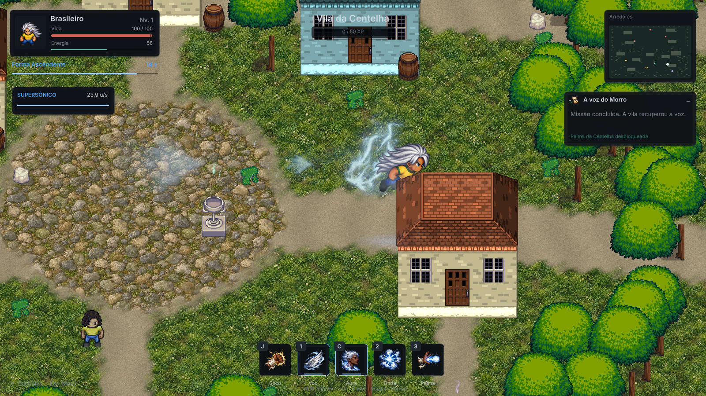

### Interface

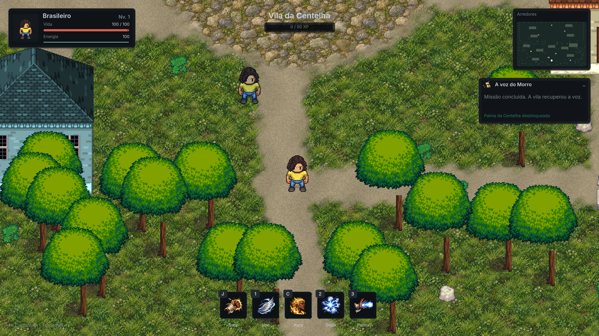

HUD compacto com vida e energia, estado da forma, velocidade de voo, progresso supersônico, minimapa e objetivo recolhível. Barra central com cinco habilidades, ícones próprios, estado de desbloqueio, recarga e descrição ao passar o mouse. O botão C acompanha o mesmo comportamento do teclado. Menu animado, pausa, controles e créditos compartilham a nova tipografia e a paleta sóbria.

Consulte também as capturas de [habilidades](docs/images/skills09.png), [controles](docs/images/controles09.png) e [créditos](docs/images/creditos09.png).

## Vila e missão: A voz do Morro

A vila mede **64×72 unidades**, incluindo o Morro do Eco, casas, caminhos e largo ao norte. A cena composta continua editável; a versão 11 acrescenta áreas e refina os objetos existentes.

1. Converse com **Seu Bonero**, ao sul da praça inicial, usando **E**.
2. Vá ao norte, derrote ou afaste os guardas e desligue os **três amplificadores** com E depois de pousar.
3. Derrote o **Companheiro** e volte a Seu Bonero.
4. Receba **100 XP**, recuperação de vida/energia e **Palma da Centelha**. Voo e Coração Canarinho são concedidos se ainda faltarem.

Objetivos, amplificadores, chefe e recompensa ficam no save. Saves antigos conservam nível e altares. A evolução de estágio 2 está disponível antes dessa missão.

Há cinco arquétipos: Cobrador, Fiscal blindado, Arauto da Vuvuzela, Batedor do Morro e Companheiro. Batedores anunciam o bote durante 0,6s; Companheiro anuncia sua rajada de três projéteis durante 0,85s. O chefe usa cinco ciclos próprios; os outros inimigos mantêm suas famílias de sprites, portes e paletas.

## Combate e progressão

- Três socos encadeados, direção travada e dano no quadro de contato; um novo comando no fim do golpe entra no buffer do combo.
- Dano de golpes: normal 1×, dourado 2,3×, Ascendente 3,15×. XP aumenta nível, dano e vida máxima.
- Altares ensinam **Voo da Centelha**, **Coração Canarinho** e **Grito da Liberdade**.
- A transformação dourada está disponível desde o início: 16s, ou 24s com Coração Canarinho. Carga incompleta apenas recupera energia.
- **Onda [2]:** 40 de energia; alcance normal/dourado/Ascendente 3,8/5,4/6,2; antecipação, impacto e empurrão.
- **Palma [3]:** aprendida na missão; 22 de energia; recarga 1,8s, ou 1,1s na Ascendente. Teste varrido do projétil evita atravessar paredes finas.

O voo é baixo e segue o chão do mapa. Inimigos corpo a corpo não alcançam a altura de cruzeiro, enquanto projéteis continuam perigosos. Salto e voo usam deslocamento visual sem desativar as colisões no chão.

## Controles

| Entrada | Ação |
| --- | --- |
| WASD / setas | Mover |
| Shift | Correr / impulso no voo |
| Ctrl | Frear no ar |
| J / clique fora da interface | Socar e encadear combo |
| Espaço | Saltar / pousar |
| E | Conversar, aprender ou interagir |
| 1 | Decolar / pousar após aprender voo |
| 2 / 3 | Onda / Palma |
| C normal | Segurar até 100% e soltar para despertar |
| C dourado | Pressionar novamente para evoluir ao estágio 2 |
| H / Esc | Controles / pausa |
| M / R | Alternar áudio / renascer após cair |

## Abrir e compilar

1. Instale **Unity 6000.6.7f1**, com Windows Build Support (Mono).
2. Clone `https://github.com/juniorrondini/Cibio.git` e adicione a pasta ao Unity Hub.
3. Abra `Assets/Cibio/RPG/Scenes/03_VilaDaCentelha.unity`, ou **Cibio > RPG > Abrir Vila da Centelha**.
4. Pressione Play e escolha Jogar ou Continuar jornada.

Built-in Render Pipeline, câmera ortográfica e ordenação pela altura dos pés. Módulos integrados à Unity; nenhum pacote pago ou chave de API é necessário para jogar ou compilar. As imagens já estão incluídas no projeto.

No PowerShell, com o editor desse projeto fechado:

```powershell
$unity = 'C:\Program Files\Unity\Hub\Editor\6000.6.7f1\Editor\Unity.exe'
$project = (Get-Location).Path
& $unity -batchmode -quit -projectPath $project `
  -executeMethod Cibio.RPG.Editor.RpgBuilder.BuildUpdatedPlayer `
  -cibio-build "$project\Builds\Windows\Cibio.exe" `
  -logFile "$project\build.log"
```

**BuildUpdatedPlayer preserva a cena existente.** Os métodos antigos Build/BuildPlayer recriam o mapa. Preserve `.meta` e GUIDs. Não versionar Library, Temp, Logs ou builds.

## Verificação

**Versão13: 756 verificações passaram** — 382 da base, 75 da evolução, 75 da vila, 157 do chefe e 67 da atualização visual/Palma. Foram capturados 32 quadros dos efeitos e 12 vistas de disparo (quatro direções em três formas), além do menu e do ícone na interface. Dano, custo, recarga, impacto único, parede e pausa foram conferidos. A cena permaneceu byte a byte idêntica e os GUIDs anteriores foram preservados. Os quatro assets finais foram reproduzidos byte a byte com as fontes incluídas.


**Versão12: 691 verificações passaram** — 382 da base, 75 da evolução, 75 da vila e 159 do chefe. Foram capturados os 128 quadros no player Windows, incluindo quatro direções dos cinco ciclos. Soco e projéteis tiveram dano e momento de contato conferidos; o projétil central causa 16 e encerra após o impacto. Missão, recompensa única e saves antigos também foram exercitados. Os 8040 blocos da cena anterior foram mantidos, sem remoções/adições de objetos, e os GUIDs existentes foram preservados. Os cinco atlas foram reproduzidos byte a byte com o importador e os originais incluídos. Relatórios em docs/verification.


**Versão11: 532 verificações passaram** — 382 da base, 75 da evolução e75 da vila/NPC. Foram exercitados 32 quadros e auditadas as células por alpha; 17 sprites de cenário também passaram na verificação de conteúdo/margens. A missão completa e o voo supersônico foram testados na cena expandida. Os 7077 blocos originais da cena continuam presentes; a versão refinada tem 8040, sem remoções e com os GUIDs anteriores preservados.

120 quadros sem capturas no Largo: 2,003s, 59,9 FPS. Amostra breve nesta maquina, nao benchmark.


A versão 11 inclui revisão específica da expansão: `Cibio.exe -cibio-village-review11 "Review11" -logFile "review11.log"`. Exercita a missão completa com o novo NPC, os 32 quadros, caminhos para as novas áreas, colisões do lago/NPC e voo rápido na avenida; também produz uma imagem completa do mapa.

**Versão 09: 457 verificações passaram** (382 da base + 75 da evolução). A revisão percorreu **272 quadros** nas quatro direções; a auditoria estática verificou **254 células únicas**, sem células vazias ou corte nas bordas. A gravação nativa ficou abaixo de saturação (pico 0.580).

120 quadros, sem capturas: 1,982s, 60,6 FPS. Amostra curta, nao benchmark.


Para revisar a ruptura e gravar a mixagem nova: `Cibio.exe -cibio-sonic-review10 "Review10" -logFile "review10.log"`. Esse modo preserva o save.

O modo de revisão executa as verificações da base e da evolução, exercita os quadros das novas animações nas quatro direções, captura o gameplay a 24fps e grava áudio do jogo em tempo real, separadamente. Não altera o save do jogador.

```powershell
.\Builds\Windows\Cibio.exe -cibio-review09 "$PWD\Review09" -logFile "$PWD\review09.log"
```

Relatórios em [docs/verification](docs/verification). A revisão verifica ativação por novo toque de C, consumo, bloqueios, evolução no ar, distância real do sonic boom, colisões, expiração, fontes, ícones e atlas. O [contato dos sprites](docs/images/quadros09.png) permite comparar os ciclos. A auditoria de alpha verifica células vazias e cortes nas bordas. Testes controlados não substituem sessões de balanceamento com jogadores.

O progresso usa **Cibio.RPG.v3.Progress**, via PlayerPrefs, e não fica no repositório. A atualização conserva essa chave. Os relatórios das revisões anteriores permanecem em docs/verification.

## Organização

| Pasta / sistema | Conteúdo |
| --- | --- |
| Assets/Cibio/RPG/Scenes | Vila editável |
| Scripts/RpgActor, RpgGame | Movimento, combate, transformação, entrada e câmera |
| Scripts/RpgPowerForm, RpgFlightWake09 | Transição, porte, rastro e sonic boom |
| Scripts/RpgInterface | HUD, menu, skills, ajuda e créditos |
| Scripts/RpgAura, RpgEffects, RpgEnergyParticles | Energia orgânica, partículas e impactos |
| Resources | Sprites, áudio, shaders, fontes e materiais |
| ThirdParty | Originais, prompts, fontes, licenças e receitas reproduzíveis |
| Assets/StreamingAssets/Cibio-Licenses | Créditos e fontes que acompanham o player |
| docs | Imagens e resultados das revisões |

Companheiro12: células128px/PPU64, cinco ações próprias. Famílias LPC: células 64px/PPU32; HeroAwakened: 128px/PPU64; HeroAscendant: 192px/PPU64. Use RpgArt.CellSize/FrameCount. Os protótipos anteriores em Assets/Cibio permanecem preservados.

## Arte, áudio e licenças

Os materiais têm licenças distintas. Preserve a atribuição por arquivo antes de reutilizar ou redistribuir.

- **Personagens LPC e derivados:** autores/camadas em [CharacterCredits.csv](Assets/Cibio/RPG/ThirdParty/CharacterCredits.csv). Originais em ThirdParty/LPCCharacter; composições e derivados CC BY-SA 4.0, com opções e atribuições dos originais.
- **Cenário LPC e construções:** ThirdParty/LPCTerrain, Colonial e Roofs; licenças herdadas CC BY-SA 3.0/4.0 conforme os arquivos.
- **Arte da versão 09:** criada com a ferramenta integrada **image_gen**, usando o personagem do projeto como referência. [Originais, prompts completos e importadores](Assets/Cibio/RPG/ThirdParty/Generated09/README.md), [manifesto de geração](Assets/Cibio/RPG/ThirdParty/Generated09/assets09.json). A importação apenas segmenta, recorta, registra e dimensiona as imagens; os desenhos não são gerados por código. Derivados distribuídos sob CC BY-SA 4.0, com créditos herdados.
- **Novos sons:** síntese DSP original, CC0 1.0; receita e medições em ThirdParty/SoundDesign09 e Resources/RpgAudio/Designed09. Efeitos anteriores usam fontes CC0 Kenney, rubberduck, TinyWorlds, Independent.nu/qubodup e faxcorp, conforme Audio-CC0.txt, Audio-05.txt e SoundDesign07/Audio-07.txt.
- **Tipografia:** Cibio UI é derivada de [Inter](https://github.com/google/fonts/tree/main/ofl/inter), OFL 1.1, com original/licença/receita em ThirdParty/Inter09. Pixelify Sans, também OFL 1.1, permanece creditada.
- **Arte e efeitos anteriores:** originais, prompts e importadores em Generated05, GeneratedVfx06 e Generated07. Energia usa texturas com alpha, ParticleSystem e bloom seletivo na camada 29.

Créditos acessíveis pelo menu. Fontes e licenças acompanham StreamingAssets/Cibio-Licenses, incluindo Fontes-09.zip. Não há sprites ou áudio extraídos das franquias citadas como inspiração.

## Continuidade

Próximas iterações: novas missões, arte exclusiva para cada inimigo, avaliação das transições em mais resoluções e sessões de balanceamento com jogadores. O estágio 2 substitui a antiga Centelha Rubra da versão 08 pela Forma Ascendente e seus assets próprios.
